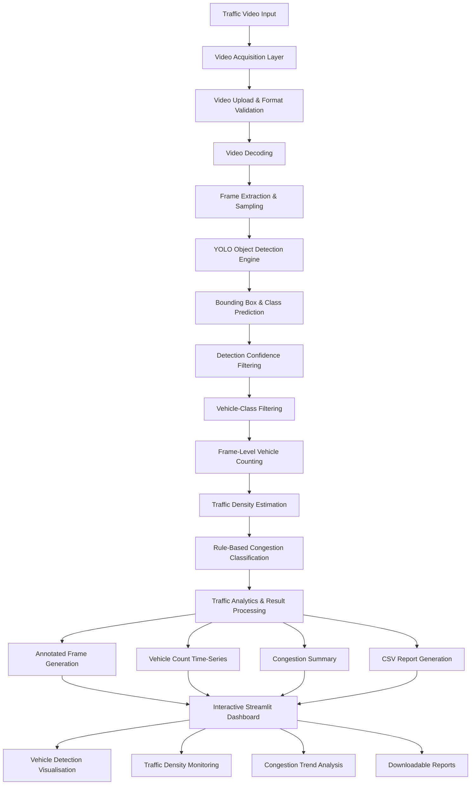
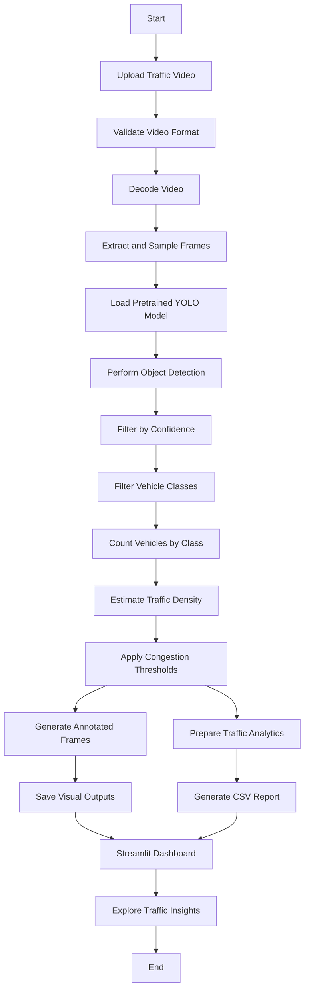

# Intelligent Traffic Monitoring and Congestion Prediction

## AI-Powered Traffic Analysis, Vehicle Detection and Congestion Monitoring

An end-to-end **Intelligent Traffic Monitoring System** that combines computer vision, deep learning-based object detection, traffic-density analysis, and data visualisation to analyse road traffic conditions from video footage. The system uses a pretrained Ultralytics YOLO model to detect vehicles and other road users, extract frame-level vehicle counts, estimate traffic density, and classify congestion levels using configurable rule-based thresholds.

An interactive Streamlit dashboard provides annotated video-frame previews, vehicle-count analytics, congestion indicators, time-series visualisations, and downloadable CSV reports.

> **Project Status:** This repository is a development-ready prototype scaffold. It supports pretrained YOLO-based object detection when the required dependencies and model weights are installed and configured. It does not contain a custom-trained traffic detection model or validated real-world congestion forecasting capability. Performance must be evaluated using representative, appropriately labelled traffic footage before making real-world claims.

---

## Project Objectives

- Develop a computer-vision-based traffic monitoring workflow.
- Detect vehicles and other road users in traffic videos.
- Count detected vehicles by class across sampled video frames.
- Estimate traffic density using configurable counting rules.
- Classify traffic congestion into Low, Moderate, and High categories.
- Analyse traffic variations across sampled video timestamps.
- Generate visual traffic monitoring reports.
- Provide a foundation for future vehicle tracking, lane-wise analytics, and congestion forecasting.

## Key Features

- **Video Upload:** Supports MP4, MOV, and AVI traffic video formats.
- **YOLO Object Detection:** Uses pretrained Ultralytics YOLO weights for object detection.
- **Vehicle Classification:** Identifies configured road-user categories such as cars, motorcycles, buses, and trucks.
- **Frame Sampling:** Processes selected frames to control computational cost.
- **Detection Filtering:** Applies configurable confidence thresholds to detection results.
- **Annotated Frame Preview:** Displays detected objects with bounding boxes and class labels.
- **Vehicle Counting:** Calculates frame-level vehicle counts by class.
- **Traffic Density Estimation:** Derives configurable density indicators from detected vehicle counts.
- **Congestion Classification:** Categorises estimated congestion as Low, Moderate, or High.
- **Traffic Trend Analysis:** Visualises vehicle-count and congestion variations over time.
- **CSV Export:** Exports frame-level analytical results.
- **Interactive Dashboard:** Presents traffic analytics and detection visualisations through Streamlit.

---

## System Architecture

The proposed system follows a modular computer-vision architecture that transforms traffic video footage into structured vehicle-detection records and traffic congestion indicators.

The architecture consists of seven major layers:

1. Video Acquisition and Input Validation
2. Video Decoding and Frame Sampling
3. YOLO-Based Object Detection
4. Vehicle-Class Filtering and Counting
5. Traffic Density Estimation
6. Rule-Based Congestion Classification
7. Dashboard Visualisation and Report Generation

### 1. Overall System Architecture



### 2. Architecture Components

| Architecture Layer | Components | Responsibility |
|---|---|---|
| Video Acquisition | Upload interface, file validation | Accepts supported traffic video files. |
| Video Processing | Video decoding, frame extraction | Reads video content and extracts frames. |
| Frame Sampling | Configurable sampling interval | Selects frames for computationally efficient analysis. |
| Object Detection | Pretrained YOLO model | Detects objects and predicts their classes and bounding boxes. |
| Detection Filtering | Confidence filtering, class selection | Retains relevant detections based on configured criteria. |
| Vehicle Counting | Class-wise counting | Calculates detected vehicle counts for each sampled frame. |
| Traffic Analytics | Density estimation | Derives traffic indicators from frame-level counts. |
| Congestion Analysis | Configurable classification rules | Assigns Low, Moderate, or High congestion labels. |
| Output Processing | Annotation, charts, CSV export | Organises and generates analytical outputs. |
| Presentation | Streamlit dashboard | Displays traffic detection and monitoring results. |

### 3. Detailed Computer Vision Pipeline

**Stage 1 — Video Acquisition**

The system accepts traffic video footage through the Streamlit upload interface.

Supported formats:

- MP4
- MOV
- AVI

Uploaded files are checked before processing to ensure they can be decoded and analysed.

**Stage 2 — Video Decoding and Frame Sampling**

The video is decoded into individual frames using the configured video-processing implementation.

Instead of analysing every frame, the system can sample frames at a configurable interval.

Example:

```text
Input Traffic Video
        |
        v
Video Decoding
        |
        v
Frame Sampling
        |
        +---- Frame 1
        +---- Frame 2
        +---- Frame 3
        +---- Frame 4
        |
        v
Selected Frames for Detection
```

Frame sampling helps reduce processing time and computational requirements.

However, a larger sampling interval may miss short-lived traffic events and reduce the temporal detail of the analysis.

**Stage 3 — YOLO-Based Object Detection**

<badge color="success">Deep Learning</badge>

The selected video frames are passed to a pretrained Ultralytics YOLO object detection model.

The detector produces:

- Bounding box coordinates.
- Predicted object classes.
- Confidence scores.

Each detected object is represented by its predicted class and bounding-box location.

The model is pretrained and is not custom-trained specifically for this project's local traffic footage.

**Stage 4 — Detection Confidence and Vehicle-Class Filtering**

Detection results are filtered according to configurable confidence thresholds and selected object classes.

Typical vehicle categories include:

| Vehicle Class | Description |
|---|---|
| Car | Passenger vehicles |
| Motorcycle | Two-wheeled motor vehicles |
| Bus | Passenger buses |
| Truck | Heavy goods vehicles |

Only the configured relevant classes are retained for vehicle-count calculations.

Confidence filtering can reduce low-confidence detections, but it does not eliminate false positives or false negatives.

**Stage 5 — Frame-Level Vehicle Counting**

The system counts the retained vehicle detections in each sampled frame.

For a sampled frame:

\[
N_t=\sum_{i=1}^{m} I(c_i\in V)
\]

Where:

- \(N_t\) = Total detected vehicles in frame \(t\).
- \(m\) = Number of retained object detections.
- \(c_i\) = Predicted class of detection \(i\).
- \(V\) = Configured set of vehicle classes.
- \(I\) = Indicator function.

Class-wise counts can also be calculated:

\[
N_{t,k}=\sum_{i=1}^{m} I(c_i=k)
\]

Where \(k\) represents a vehicle category such as car, motorcycle, bus, or truck.

These counts represent detected objects in a sampled frame, not unique vehicles passing through a road segment.

**Stage 6 — Traffic Density Estimation**

Traffic density is estimated from frame-level vehicle counts using configurable rules.

A simple normalised indicator can be expressed as:

\[
D_t=\frac{N_t}{C}\times100
\]

Where:

- \(D_t\) = Estimated density indicator.
- \(N_t\) = Detected vehicle count.
- \(C\) = Configured reference count.

The reference count must be selected and calibrated for the specific camera view and road geometry.

This formula produces a normalised count indicator, not a physically measured traffic density in vehicles per kilometre.

**Stage 7 — Congestion Classification**

The estimated density indicator is mapped into congestion categories using configurable thresholds.

Example conceptual classification:

| Density Indicator | Congestion Category |
|---|---|
| Below configured lower threshold | Low |
| Between lower and upper thresholds | Moderate |
| Above configured upper threshold | High |

The exact thresholds should be configured and validated for the camera location.

Congestion classification in this prototype is rule-based, not a separately trained congestion prediction model.

**Stage 8 — Traffic Analytics and Visualisation**

The processed frame-level results are organised into structured analytical outputs.

Possible outputs include:

- Total vehicle counts.
- Car, motorcycle, bus, and truck counts.
- Estimated density indicators.
- Congestion categories.
- Frame timestamps.
- Annotated detection previews.
- Vehicle-count trend charts.
- Downloadable CSV reports.

**Stage 9 — Interactive Dashboard**

The Streamlit dashboard provides an interface for exploring traffic monitoring results.

Dashboard sections can include:

- Uploaded video information.
- Detection configuration.
- Annotated frame previews.
- Vehicle counts by class.
- Traffic density indicators.
- Congestion distribution.
- Time-series analytics.
- CSV report downloads.

### 4. End-to-End System Workflow



---

## Traffic Analytics Methodology

### 1. Object Detection

The pretrained YOLO detector identifies road users in selected video frames.

Detection outputs include:

- Object class.
- Bounding box.
- Confidence score.

The detector's performance depends on lighting, camera position, vehicle size, occlusion, image resolution, and domain similarity between training data and uploaded footage.

### 2. Vehicle Counting

The system calculates vehicle counts for each sampled frame.

Example analytical structure:

| Timestamp | Cars | Motorcycles | Buses | Trucks | Total |
|---|---:|---:|---:|---:|---:|
| Frame observation 1 | — | — | — | — | — |
| Frame observation 2 | — | — | — | — | — |
| Frame observation 3 | — | — | — | — | — |

Actual values are generated when a traffic video is processed.

### 3. Traffic Density Estimation

The prototype derives a configurable density indicator from detected vehicle counts.

Density indicators can be used to compare sampled observations within the same camera view, provided the camera position and analysis configuration remain consistent.

For meaningful traffic density measurement, additional road geometry and spatial calibration are required.

### 4. Congestion Classification

The system maps the estimated density indicator to three configurable categories:

- Low
- Moderate
- High

This is a rule-based classification mechanism.

It does not independently forecast future congestion or establish traffic flow, road occupancy, or queue length.

### 5. Traffic Trend Analysis

The sampled frame results can be visualised over video timestamps to examine changes in:

- Total vehicle detections.
- Individual vehicle categories.
- Estimated density.
- Congestion labels.

These trends describe the analysed video interval and should not be interpreted as long-term traffic forecasts.

---

## Technology Stack

| Category | Technologies |
|---|---|
| Programming Language | Python |
| Computer Vision | OpenCV |
| Deep Learning | Ultralytics YOLO |
| Object Detection | Pretrained YOLO Weights |
| Data Processing | Pandas, NumPy |
| Data Visualisation | Matplotlib, Plotly |
| Dashboard | Streamlit |
| Data Export | CSV |
| Model Evaluation | Precision, Recall, mAP |
| Development Environment | VS Code, Jupyter Notebook |
| Version Control | Git, GitHub |

---

## Repository Structure

```text
Intelligent-Traffic-Monitoring/
│
├── dashboard/
│   └── app.py
│
├── src/
│   ├── detector.py
│   ├── traffic_analysis.py
│   └── video_utils.py
│
├── data/
│   ├── input/
│   │   └── README.md
│   └── output/
│       └── README.md
│
├── models/
│   └── README.md
│
├── reports/
│   └── figures/
│       └── README.md
│
├── docs/
│   ├── architecture.md
│   ├── methodology.md
│   └── limitations.md
│
├── tests/
│   └── README.md
│
├── requirements.txt
├── config.py
├── README.md
└── .gitignore
```

*This structure reflects the intended project organisation. Adjust it to match the actual files committed to your repository.*

---

## Installation and Setup

### Prerequisites

- Python 3.10 or 3.11
- pip package manager
- Git (optional)
- Sufficient system memory for video processing
- Compatible hardware for the selected YOLO inference configuration

### 1. Clone the Repository

```bash
git clone <repository-url>
cd Intelligent-Traffic-Monitoring
```

### 2. Create a Virtual Environment

```bash
python -m venv venv
```

**Windows:**

```bash
venv\Scripts\activate
```

**macOS / Linux:**

```bash
source venv/bin/activate
```

### 3. Install Dependencies

```bash
pip install -r requirements.txt
```

### 4. Configure the YOLO Model

Ensure the selected pretrained Ultralytics YOLO weights are available.

The project may use a model weight file downloaded through the configured Ultralytics workflow or a locally supplied compatible weight file.

Verify the model version, source, and licence before redistribution or commercial use.

### 5. Launch the Streamlit Dashboard

```bash
streamlit run dashboard/app.py
```

### 6. Analyse Traffic Footage

1. Open the Streamlit dashboard.
2. Upload a supported traffic video.
3. Configure the frame sampling interval.
4. Set the detection confidence threshold.
5. Select the vehicle classes to analyse.
6. Start the video analysis.
7. Inspect annotated frames and vehicle counts.
8. Explore density and congestion visualisations.
9. Export the generated CSV report.

> **Setup note:** The instructions assume the repository's application and configured model-loading code support these operations. Confirm the actual script arguments and configuration names before publishing exact execution instructions.

---

## Generated Outputs

The system is designed to produce the following outputs:

| Output | Description |
|---|---|
| Annotated Frame | Traffic frame with detected objects and bounding boxes. |
| Vehicle Counts | Frame-level counts for selected vehicle categories. |
| Density Indicator | Configurable normalised vehicle-count indicator. |
| Congestion Category | Low, Moderate, or High rule-based label. |
| Time-Series Charts | Vehicle-count and congestion trends over sampled timestamps. |
| CSV Report | Structured frame-level traffic analysis results. |

### Example CSV Schema

```csv
timestamp,frame_number,cars,motorcycles,buses,trucks,total_vehicles,density_indicator,congestion_level
```

The actual output columns should match the implementation.

---

## Evaluation Methodology

The system should be evaluated using representative traffic videos with manually annotated ground truth.

### 1. Object Detection Evaluation

| Metric | Purpose |
|---|---|
| Precision | Measures the proportion of predicted detections that are correct. |
| Recall | Measures the proportion of ground-truth objects detected. |
| mAP@0.5 | Measures detection performance at an IoU threshold of 0.5. |
| mAP@0.5:0.95 | Measures detection performance across multiple IoU thresholds. |

### 2. Vehicle Counting Evaluation

Compare automated counts against manually verified frame-level counts.

Potential metrics:

- Mean Absolute Error (MAE).
- Root Mean Squared Error (RMSE).
- Mean Absolute Percentage Error (MAPE), where meaningful and zero-count cases are handled.

### 3. Tracking Evaluation

If persistent object tracking is implemented, suitable evaluation metrics include:

- IDF1.
- HOTA.
- MOTA.

### 4. Congestion Evaluation

To evaluate congestion classification:

1. Define ground-truth congestion labels.
2. Establish the camera location and observation conditions.
3. Define a suitable evaluation period.
4. Compare predicted categories against reference labels.
5. Report precision, recall, F1-score, and confusion matrix.

For actual future congestion prediction, define a prediction horizon and appropriate ground-truth traffic measurements before reporting forecasting performance.

> **Results Policy:** Do not invent detection accuracy, vehicle-counting performance, congestion prediction scores, or benchmark improvements. Report only measurements obtained from a documented evaluation dataset.

---

## Important Interpretation and Limitations

- The project uses a pretrained YOLO detector rather than a custom-trained traffic model.
- Detection accuracy depends on video quality, camera angle, lighting, occlusion, object size, and scene conditions.
- Frame sampling can miss short-duration events.
- Vehicle counts are frame-level detections, not unique vehicle counts.
- Vehicle counts are not equivalent to traffic flow, road occupancy, or queue length.
- The density indicator is a configurable estimate, not a physical measurement of vehicles per kilometre.
- Congestion categories are rule-based and depend on camera-specific thresholds.
- The system does not currently provide validated future congestion forecasting.
- Speed estimation requires camera calibration, known road reference measurements, and reliable object tracking.
- Results from one camera location may not generalise to another.
- Real-world deployment requires local evaluation and calibration.

## Data Privacy and Responsible Use

- Use only traffic footage you own or are authorised to process.
- Avoid collecting or publishing identifiable faces and licence plates.
- Apply appropriate anonymisation or blurring where necessary.
- Protect uploaded video files and generated outputs.
- Define suitable data-retention and deletion policies.
- Follow applicable privacy and traffic-surveillance requirements.
- Do not use this educational prototype as an enforcement or safety-critical traffic-control system.
- Require human review before operational decisions are made from analytical outputs.

---

## Future Enhancements

1. **Object Tracking:** Integrate ByteTrack or another suitable tracker to maintain persistent vehicle identities across frames.
2. **Unique Vehicle Counting:** Implement virtual counting lines to measure directional vehicle crossings.
3. **Lane-Wise Analysis:** Add lane segmentation and individual lane congestion indicators.
4. **Speed Estimation:** Apply camera calibration, homography, and reliable tracking for approximate vehicle-speed estimation.
5. **Custom Model Training:** Fine-tune YOLO on locally representative, labelled traffic footage.
6. **Traffic Forecasting:** Develop time-series models using historical counts and external traffic variables.
7. **Real-Time Video Processing:** Integrate live camera streams and appropriate streaming infrastructure.
8. **Congestion Alerts:** Add configurable threshold-based notifications.
9. **Multi-Camera Monitoring:** Combine observations from multiple authorised traffic cameras.
10. **Advanced Analytics:** Explore traffic-flow, vehicle trajectory, and queue-length estimation.

## Conclusion

The Intelligent Traffic Monitoring and Congestion Prediction project demonstrates how computer vision and deep learning-based object detection can be integrated with traffic analytics and interactive visualisation.

By combining pretrained YOLO detection, vehicle-class filtering, frame-level counting, configurable density estimation, and rule-based congestion classification, the system provides a modular foundation for exploring intelligent traffic monitoring.

The project also establishes a pathway toward more advanced capabilities, including vehicle tracking, lane-wise traffic analysis, calibrated speed estimation, and data-driven congestion forecasting.

---

## Author

**Mohamed Riyaz S.**  
Integrated M.Tech – Computer Science and Engineering (Business Analytics)  
Vellore Institute of Technology (VIT), Chennai
